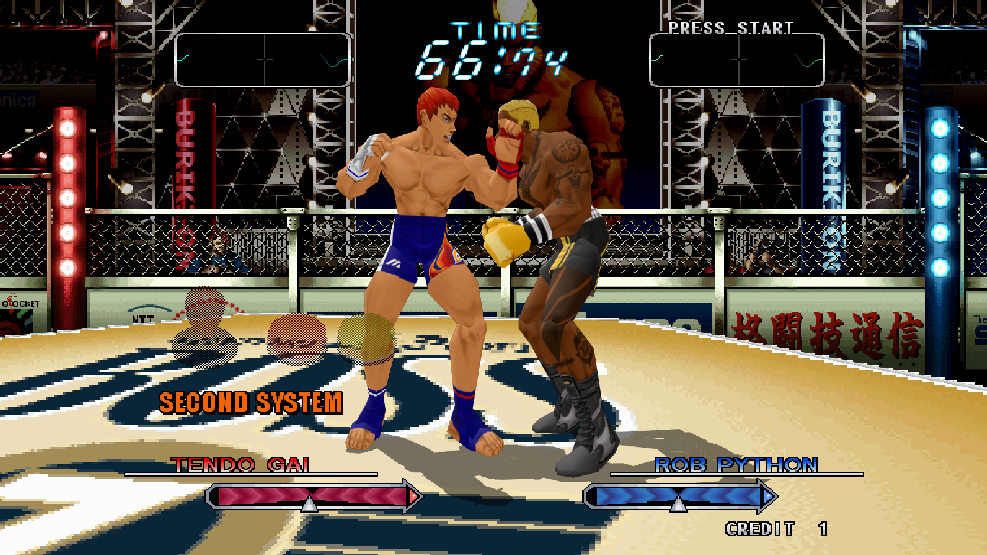
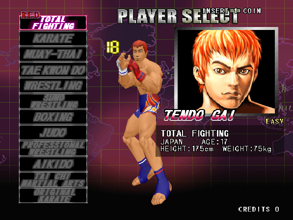
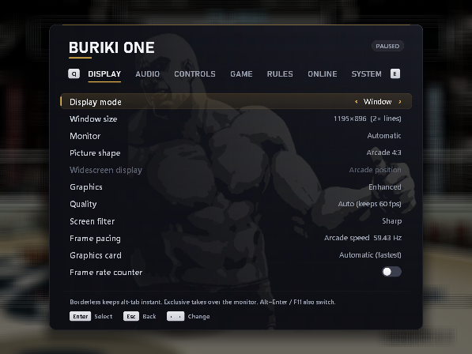
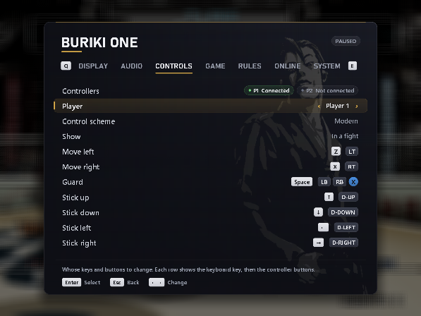

# ReBuriki

**Buriki One, rebuilt for Windows.** 
An unofficial PC version of SNK's 1999 Hyper Neo Geo 64 arcade fighter.

**[Download](../../releases/latest)** · [Install](#install) · [How to play](#how-to-play) · [The menu](#the-menu) · [Controls](#controls) · [Playing online](#playing-online-experimental) · [Troubleshooting](#troubleshooting) · [FAQ](#faq)

> [!IMPORTANT]
> ReBuriki does **not** include the game. You need your own legally obtained copies of two arcade ROM sets, as
> MAME names them: `buriki.zip` (Buriki One, rev. B) and `hng64.zip` (the Hyper Neo Geo 64 system ROMs). Setup
> builds the game from them on your PC. The download contains only ReBuriki's own code and the open-source
> tools it uses.

## Contents

- [What ReBuriki adds](#what-reburiki-adds)
- [The game](#the-game)
- [What you need](#what-you-need)
- [Install](#install), [update](#updating) and [uninstall](#uninstalling)
- [How to play](#how-to-play)
- [The menu](#the-menu)
- [Picture and graphics](#picture-and-graphics)
- [Controls](#controls)
- [Arcade settings, and Silber](#arcade-settings-and-silber)
- [Playing online (experimental)](#playing-online-experimental)
- [Your files](#your-files)
- [Troubleshooting](#troubleshooting)
- [FAQ](#faq)
- [Known gaps](#known-gaps)
- [For developers](#for-developers)
- [About and credits](#about-and-credits)

## What ReBuriki adds

| | |
|---|---|
| **Sharper 3D** | The fighters are redrawn on your graphics card at your screen's resolution, with smooth edges and textures. Or keep the original picture (F9 switches). |
| **Widescreen** | Fights fill a 16:9 screen, up to 21:9, with more of the arena at the sides. The health bars can stay where the arcade put them or sit at the screen edges. |
| **Your screen, your way** | Window, borderless or exclusive full screen; 4:3, stretched or pixel-perfect scaling; sharp, smooth or scanline filter. |
| **English or Japanese** | Choose the board's region from the menu. |
| **Controllers** | Xbox-style controllers for two players, with control schemes made for this game (move on the left stick, attack on the right, a guard button, A selects), a fully custom scheme, keyboard, and remapping for both. |
| **Arcade settings** | Free play, difficulty, attack power, timer speed and more from an in-game menu, plus an option to have the hidden fighter Silber from the start. |
| **Online play (experimental)** | Two players over the internet or a home network, with rollback so it stays responsive on an ordinary connection. See [Playing online](#playing-online-experimental). |
| **Native** | Not an emulator: the arcade code is recompiled into a Windows program. |

 

## The game

*Buriki One: World Grapple Tournament '99 in Tokyo* is a 3D fighting game SNK released in arcades in 1999
on its Hyper Neo Geo 64 board. Each fighter stands for one
fighting style, and the select screen lists them by style: Total Fighting, Karate, Muay Thai, Tae Kwon Do,
Wrestling, Sumo Wrestling, Boxing, Judo, Professional Wrestling, Aikido and Tai Chi. A twelfth, Silber
("Original Karate"), is hidden.

It also controls unlike other fighting games: two **buttons** move your fighter and the **stick** attacks.

## What you need

- 64-bit Windows 10 or 11.
- A graphics card with Direct3D 11. Without one the game still runs, with the original picture and no
  pause menu.
- Your own `buriki.zip` and `hng64.zip` (see the note at the top).
- About 500 MB of free disk space while installing. The installed game takes about 180 MB.
- For a controller: an Xbox-style (XInput) one. The keyboard always works.

## Install

1. Download **`ReBuriki-Setup.zip`** from the [latest release](../../releases/latest) and unzip the whole
   folder anywhere.
2. Run **`Setup.exe`**.
3. Choose your `buriki.zip` and `hng64.zip` and where to install, then press **Install**. If the two zips
   are next to `Setup.exe` or in your Downloads folder, Setup finds them itself.

Setup checks the ROMs, builds the game from them on your PC and adds desktop and Start menu shortcuts. It
takes a minute or two on a recent PC. No administrator rights are needed and nothing is downloaded:
everything Setup uses is in the folder you unzipped, which you can delete afterwards.

Any MAME version's sets work as long as they are complete: Setup finds the files it needs by checksum,
whatever they are named. `hng64.zip` must include the I/O board file `tmp87ph40an.bin`, which MAME sets have
had for some years.

> [!NOTE]
> Setup isn't code-signed, so Windows may show **"Windows protected your PC"**. Choose **More info**, then
> **Run anyway**. If your antivirus blocks `Setup.exe`, that is an automatic guess about new, unsigned
> programs: allow it in the antivirus's history list and run Setup again. Please don't turn your antivirus off.

### Updating

Download the new `ReBuriki-Setup.zip` and install into the same folder as before. Your settings, controls
and the arcade's saved records are kept.

### Uninstalling

**Windows Settings → Apps → ReBuriki (Buriki One PC port) → Uninstall**, or run `Uninstall.exe` in the
install folder. It asks whether to keep your settings, and removes only the game's own files.

## How to play

1. Start the game from its shortcut. It boots like the arcade machine, into the title and demo screens.
2. **Insert a coin**, then press **Start**. With **Free play** on (menu, Game page), Start alone is enough.
3. Choose your fighter with the stick and confirm with **Select** (A on a controller, Z on the keyboard).
4. In a fight, **step** left and right to close in or back off, **attack** with the stick, and **guard**
   by holding both step buttons or the Guard button.

A second player can join at any time by putting in a coin and pressing their Start, as in the arcade.

To see the commands on screen while you play, turn on **Move commands on screen** (menu, Rules page). It is
the arcade's own "COMMAND DISP." option.

## The menu

Press **Back + Start** together on a controller (View + Menu on newer Xbox pads), or **Tab** / **Esc** on the
keyboard. The game pauses while the menu is open. Its picture is one of the game's fighting-style portraits,
a different one each time.

| | Controller | Keyboard |
|---|---|---|
| Move | D-pad or stick | Arrow keys |
| Choose | A | Enter |
| Back | B | Esc |
| Switch pages | LB / RB | Q / E |
| Close | Start | Tab |

| Page | What's there |
|---|---|
| **Display** | Window / borderless / exclusive full screen, window size, monitor, picture shape (4:3, stretch, whole-number, widescreen), where the health bars sit in widescreen, enhanced or original graphics, quality, screen filter, frame pacing, graphics card, frame-rate counter |
| **Audio** | Volume, mute |
| **Controls** | Control scheme (Modern, Classic, Buttons attack, Custom); then in three groups: change any key or controller button, up to three buttons per control, what each stick does, stick dead zone, restore defaults |
| **Game** | Unlock Silber, free play, language / region (applies after a restart) |
| **Rules** | The arcade operator's settings: difficulty, attack power and timer speed (1 player and versus), continue, replay, blood, move commands on screen, sound in the title demo |
| **Online** | Experimental. Host a game, join one by address, input delay, this PC's address, leave |
| **System** | Resume, the arcade's operator menu, restart, quit |

## Picture and graphics

All of this is on the menu's Display page.

- **Graphics: Enhanced or Original arcade.** Enhanced redraws the 3D fighters on your graphics card at high
  resolution. Original is the arcade board's own 512×448 picture. **F9** switches while you play.
- **Quality.** Auto picks the sharpest setting your PC holds at full speed and steps down if it ever can't.
  The fixed settings run from Performance (2×) to Extreme (8×).
- **Picture shape.** Arcade 4:3, stretch to fill, 4:3 at a whole-number scale, or **Widescreen**.
  Widescreen shows more of the arena at the sides in fights, up to 21:9; the title, the select screens and
  other flat screens stay 4:3. It needs Enhanced graphics.
- **Widescreen display.** Where the health bars and the boxes at the top sit in a widescreen fight: where
  the arcade put them, or out at the edges of the screen.
- **Screen filter.** Sharp pixels, smooth scaling, or arcade-monitor scanlines.
- **Frame pacing.** Arcade speed is the board's own 59.43 frames a second. Display vsync is smoother on a
  60 Hz screen but about 1% fast.
- **Display mode.** Window, borderless full screen (alt-tab stays instant) or exclusive full screen.
  **Alt+Enter** or **F11** also switch.

| Key | Does |
|---|---|
| Alt+Enter or F11 | Window / full screen |
| F9 | Enhanced graphics on / off |
| F2 | The arcade's Test button (operator menu) |
| 9 | The arcade's Service button |

## Controls

The game calls its two buttons L and R. In a fight they step left and step right, and held together they
raise your guard. On the arcade cabinet they also confirm on the game's own screens, such as choosing your
fighter. ReBuriki treats stepping, guarding and confirming as separate controls, so a trigger doesn't pick a
fighter and A doesn't step.

The first controller connected is player 1 and the second is player 2.

### Controller schemes

A controller comes with three ready-made **control schemes** (menu, Controls page), and **Custom**, your own:

| | Modern (default) | Classic | Buttons attack |
|---|---|---|---|
| **In a fight** | | | |
| Step left / right | Left stick, or LT / RT | LT, LB / RT, RB | Left stick, or LT / RT |
| Attack | Right stick, or D-pad | Either stick, or D-pad | Y, A, X, B (up, down, left, right), right stick or D-pad |
| Guard | LB, RB or X | X, or both triggers | LB or RB |
| **On the game's screens** | | | |
| Move the cursor | Either stick, or D-pad | Either stick, or D-pad | Either stick, or D-pad |
| Select / other button | A / B | A / B | A / B |
| **The cabinet** | | | |
| Start / insert coin | Start / Back | Start / Back | Start / Back |
| Menu | Back + Start | Back + Start | Back + Start |

- **Modern** plays like a modern game: move with the left stick, attack with the right.
- **Classic** keeps the stick for attacks, as on the cabinet.
- **Buttons attack** is for players who would rather press buttons than flick a stick.
- **Custom** is whatever you set. Change anything about the controller and the scheme becomes Custom,
  starting from the scheme you were on. Custom is remembered, so you can try another scheme and come back.

Each player has their own scheme.

### Keyboard

The keyboard is the same in every scheme:

| | Player 1 | Player 2 |
|---|---|---|
| Stick (attacks, and the cursor) | Arrow keys | R F D G (up, down, left, right) |
| Step left / right (and select / other on screens) | Z / X | A / S |
| Guard | Space, or Z and X together | A and S together |
| Start / insert coin | 1 / 5 | 2 / 6 |
| Buttons 3 and 4 (spare) | C, V | Q, W |
| Menu | Tab or Esc | |

### Changing controls

On the menu's Controls page, **Show** switches between three groups: in a fight; the game's screens and the
cabinet; sticks. Choose a control and press Enter (A on a controller) to open its box:

- Press a controller button to add it, and again to take it off. A control can have up to three.
- Press a key to make it the keyboard key.
- The same key or button can be on several controls.
- Esc closes the box. With only a controller, it closes by itself after a few seconds.

In the sticks group, each stick can **step left and right**, **attack**, or be switched **off**, and you
can set how far a stick must move before it counts. **Restore defaults** puts both players back on the
Modern scheme and the original keys.

 

## Arcade settings, and Silber

The arcade machine had an operator's menu for the owner of the cabinet. ReBuriki puts its settings in the
pause menu, and keeps them in the arcade's own save memory, so they agree with the original menu.

- **Free play** (Game page). On: Start alone begins a game. Off: insert a coin first.
- **Rules page.** Difficulty; attack power and timer speed, separately for one player and versus; continue;
  the slow-motion replay; blood; move commands on screen; sound in the title demo. They apply from the next
  fight.
- **Language / region** (Game page). Japan (Japanese), USA or World (English). The board reads it at power
  on, so it applies after a restart.
- **The arcade's operator menu** itself is still there: System page, or F2. It has the input and sound
  tests and the bookkeeping.

**Silber**, the final boss, is the hidden twelfth fighter: "Original Karate", at the bottom of the style
list. With **Unlock Silber** on (Game page, on by default) he can be picked from the start. Turn it off to
earn him the arcade's way; what you have earned is kept either way.

## Playing online (experimental)

**This part is experimental.** It has been tested thoroughly with two copies of the game on one PC,
through simulated slow and unreliable connections, and the two stayed in step every time. It has not
yet been played much between two real PCs over the internet. It connects the two players' PCs directly:
there is no server, lobby or matchmaking, so you arrange a game with someone yourselves. Nothing here
affects ordinary play. If something goes wrong, please report it with `buriki.log` from both players
(see [Troubleshooting](#troubleshooting)); the game writes a line there if the two sides ever disagree.

Two players, each on their own PC with their own copy of ReBuriki. One hosts and is player 1; the other
joins and is player 2. Each of you plays with your own Player 1 keys or first controller.

1. **Host:** open the menu, go to **Online**, choose **Host a game**. The game restarts and shows a
   waiting screen with your address.
2. **Joiner:** on the Online page choose **Address to join**, type the host's address (Enter to start
   typing, Ctrl+V pastes), then **Join a game**.
3. The game starts from power on for both of you, with the host's settings: free play, difficulty and
   the other rules, and whether Silber is unlocked. Put in a coin (unless free play is on), press Start,
   and the second player pressing Start is the arcade's "here comes a new challenger".

To stop, either player chooses **Leave the online game** (or closes the game). The other is told, and
both go back to ordinary play.

Things to know:

- **Same network** (two PCs at home): the joiner types the address the host's waiting screen shows.
- **Over the internet:** the joiner needs the host's public address (the host can search the web for
  "what is my IP"), and the host's router must forward **UDP port 7600** to the host's PC. A virtual-LAN
  tool such as Tailscale, ZeroTier or Radmin VPN avoids the router setup: both install it and the joiner
  types the host's address in that tool.
- **Windows Firewall** asks the first time you host. Choose Allow.
- **Both players need the same Language / region** (Game page) and the same game files and version of
  ReBuriki. If not, the joiner is told so and nothing starts.
- **Pausing pauses both.** While one player has the menu open, the other sees "Waiting for the other
  player".
- **Input delay** (Online page, the host's choice): the number of frames before the game sees a button
  press. 2 suits most connections. Raise it if the picture often jumps; lower it on a very good
  connection.
- With the frame-rate counter on (Display page), the ping is shown next to it.
- The joiner's own arcade save memory is not touched; the host's is used and kept.

<b>How it works, briefly</b>

Both copies run the whole game from power on with the same settings, and send each other only their button
presses. Each plays your own presses a couple of frames late (the input delay), which is usually enough for
the other player's to arrive in time. When they are late, the game carries on with a guess; if the guess
was wrong, it goes back to its saved state from that moment and replays the frames since, in a few
thousandths of a second. That is "rollback". Once a second the two copies compare a fingerprint of the
game's memory, to be sure they are still playing the same game.

## Your files

The game keeps everything in its install folder. It sends nothing over the internet except, in an online
game, your button presses to the other player.

| File | What it is |
|---|---|
| `settings.ini` | The pause menu's settings |
| `controls.ini` | Keys, controller buttons and schemes. It can be edited by hand; the comments at its top explain it |
| `nvram.bin` | The arcade's own save memory: operator settings, records, what you have unlocked |
| `buriki.log` | What happened in the last run. `buriki.old.log` is the run before |
| `setup.log` | What Setup did |

To start completely fresh, delete `settings.ini`, `controls.ini` and `nvram.bin` while the game is closed.

## Troubleshooting

<b>Setup says a ROM file is missing or wrong.</b>

Setup names the file. `buriki.zip` must be the rev. B set, and `hng64.zip` must include the I/O board file
`tmp87ph40an.bin`: older MAME sets don't have it. Both must be complete; the names inside don't matter.

<b>Windows or my antivirus stops Setup.</b>

Setup isn't code-signed. On "Windows protected your PC" choose **More info**, then **Run anyway**. If an
antivirus removed `Setup.exe` or a file in the `files` folder, restore it from the antivirus's history and
allow it, then run Setup again. Unzipping the download again also brings the files back.

<b>The picture looks wrong, or the 3D is missing.</b>

Press **F9** to switch between Enhanced and Original graphics. If Original looks right and Enhanced doesn't,
update your graphics driver, and please report it with `buriki.log`. On a PC with two graphics cards, try
the other one (Display page, Graphics card; it applies after Restart game).

<b>The game runs slowly or stutters.</b>

Set Quality to **Auto** or **Performance** (Display page). Turn on the frame-rate counter to see the speed:
it should read about 59 or 60. If Frame pacing is on Display vsync and your screen is not close to 60 Hz,
use Arcade speed.

<b>The pause menu doesn't open.</b>

The menu is drawn with Direct3D 11. On a PC without it the game falls back to a plain picture and the menu
can't be shown. `settings.ini` and `controls.ini` can still be edited by hand.

<b>My controller doesn't work, or the buttons are odd.</b>

ReBuriki recognises Xbox-style (XInput) controllers. PlayStation controllers work through Steam or a tool
such as DS4Windows, and many arcade sticks have an XInput mode. The Controls page shows whether each
player's controller is connected. If the buttons aren't what you expect, choose a **Control scheme** there,
or **Restore defaults**.

<b>There is no sound.</b>

Check Volume and Mute on the Audio page, and that Windows is playing to the right device. The title demo is
silent if "Sound in the title demo" is off (Rules page).

<b>Online: the joiner gets "no answer".</b>

- The host must be on the waiting screen before the joiner joins.
- On the same network, use the address on the host's waiting screen.
- Over the internet, use the host's public address, and the host's router must forward UDP port 7600 to
  the host's PC, or both use a virtual-LAN tool.
- The host must have allowed the game through Windows Firewall.

<b>Online: "the two players' games differ".</b>

Both players need the same Language / region (Game page), the same ROM sets and the same version of
ReBuriki.

<b>Reporting a problem.</b>

Open an [issue](../../issues) and attach `buriki.log` from the install folder (the previous run's is
`buriki.old.log`), and `setup.log` if the problem was with installing. For an online problem, the log from
both players helps.

## FAQ

<b>Is this an emulator?</b>

No. ReBuriki is a *static recompilation*: a tool translates the arcade game's MIPS processor code into C,
which is compiled into a native Windows program, with the arcade hardware (graphics, sound, inputs) replaced
by portable code. This happens on your PC when you install, from your own ROMs.

<b>Which ROMs do I need?</b>

The MAME sets `buriki.zip` (Buriki One: World Grapple Tournament '99 in Tokyo, rev. B) and `hng64.zip` (the
Hyper Neo Geo 64 system ROMs). Please don't ask where to get them.

<b>Why does Setup build the game instead of just installing it?</b>

Because the game's program belongs to its owners, ReBuriki can't ship it in any form. So the download holds
only ReBuriki's own code and the tools, and the translation of the game's code happens on your PC from your
own ROMs. Nothing made from the game is ever distributed.

<b>How do I play as Silber?</b>

He is the twelfth style, "Original Karate", at the bottom of the list on the player select screen. The menu's
"Unlock Silber" option (Game page) is on by default. Turn it off to earn him the arcade's way; what you have
earned is kept either way.

<b>Can two people play on one PC?</b>

Yes: two controllers, a controller and the keyboard, or both on the keyboard. The second player puts in a
coin and presses Start.

<b>Does online play need an account or a server?</b>

No. The two PCs connect directly to each other. That is also why there is no lobby: you arrange a game with
someone yourselves.

<b>Where are my settings saved?</b>

In the install folder: `settings.ini` (menu settings), `controls.ini` (keys and buttons) and `nvram.bin` (the
arcade's own settings and records). See [Your files](#your-files).

<b>What do I need to run it?</b>

64-bit Windows 10 or 11 and a graphics card with Direct3D 11. Without one the game falls back to the original
picture.

## Known gaps

- The sound chip's echo effect isn't reproduced. The game uses it, but how the chip does it isn't
  documented, and no emulator has it yet.
- Online play is experimental and connects directly: no lobby, and over the internet the host needs a
  forwarded port or a virtual-LAN tool.
- Setup isn't code-signed, so Windows warns about it.
- Windows only.

Everything else is believed to match the arcade. Reports are welcome.

## For developers

- [docs/DEVELOPING.md](docs/DEVELOPING.md): building from source, the tools, the test options.
- [NOTES.md](NOTES.md): the project's working diary: what was found in the game and the hardware, what was
  measured, and why things are the way they are.
- [docs/RELEASE_NOTES.md](docs/RELEASE_NOTES.md): what each release contains.

The repository contains no game data and nothing made from the game.

## About and credits

ReBuriki was made with Claude, Anthropic's AI model.

It stands on other people's work:

- **[MAME](https://www.mamedev.org/)** and its Hyper Neo Geo 64 driver. The parts of ReBuriki that stand in
  for the arcade hardware are ports of MAME code; [LICENSE.md](LICENSE.md) lists each one with its authors.
- **[N64Recomp](https://github.com/N64Recomp/N64Recomp)** by Wiseguy, the tool that translates the game's
  processor code.
- **[ReLayer](https://github.com/QuietClubGames/ReLayer)**, the sister project for Fighting Layer, whose
  front end and installer this one grew from.

The licences are in [LICENSE.md](LICENSE.md): the project's own code is MIT, and the parts ported from MAME
keep MAME's licences. They cover ReBuriki only, not the game.

ReBuriki is a fan project, not affiliated with or endorsed by SNK. Buriki One and Hyper Neo Geo 64 are
trademarks of their owners.
